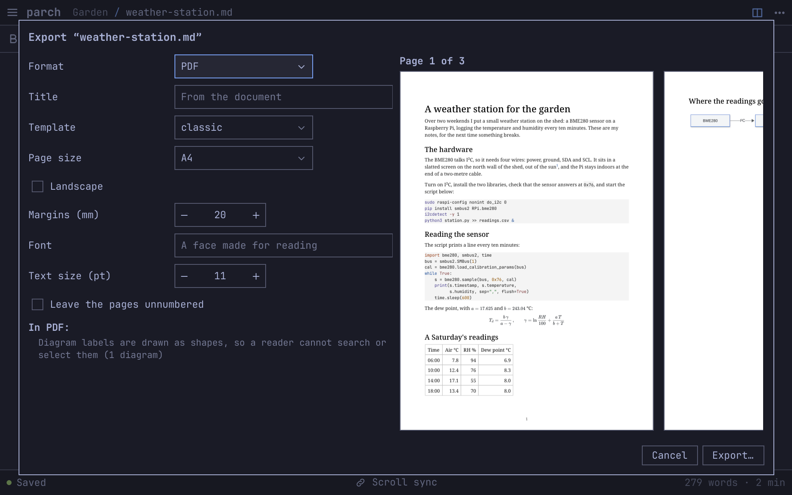

# parch

parch is a Markdown writing app for Omarchy, in the spirit of iA Writer: you
write plain Markdown with its punctuation in view, and read it beside the text
as a preview with coloured code, math, diagrams and citations. It saves as you
type and brings your text back after a crash. Your writing stays in ordinary
files on your computer, and there is no account.

[Install](#install) · [Guide](docs/guide.md) · [Changelog](CHANGELOG.md) · [Releases](https://github.com/willykev/parch/releases)


## Features

- **Preview beside the text.** `Ctrl+Alt+2` shows tables, coloured code,
  math, Mermaid diagrams and footnotes beside the Markdown, scrolling with it.
- **Citations.** Write `[@key]` against a BibTeX or CSL file, and the preview
  sets the citations and the bibliography in APA, Chicago, IEEE, MLA or a
  style of your own.
- **Export and print.** PDF, Word, EPUB, HTML or Markdown, with the PDF's
  pages shown before anything is written.
- **Vim keys.** Normal, Insert and Visual modes, registers, search and `:w`,
  turned on in **Preferences**; `Ctrl` keys keep their meaning.
- **Focus and spelling.** `Ctrl+Shift+D` dims all but the sentence you are on,
  and misspelled words are underlined as you write.
- **Never lose a word.** parch saves a moment after you pause, keeps unsaved
  text through a crash, keeps earlier versions to go back to, and shows both
  sides when a file changes on disk.
- **Your library.** Folders, drafts and recent files beside the text;
  `Ctrl+Shift+O` finds any document by name.

## Install

parch runs on Omarchy and other Arch Linux systems, on x86_64 and ARM64.

```sh
curl -LO "https://github.com/willykev/parch/releases/latest/download/parch-writer-$(uname -m).pkg.tar.zst"
sudo pacman -U "parch-writer-$(uname -m).pkg.tar.zst"
```

Then open **parch** from the app launcher, or run `parch` with the files to
open. The package is `parch-writer`; the command is `parch`.

To build from source instead:

```sh
sudo pacman -S --needed base-devel git qt6-base qt6-declarative qt6-svg qt6-wayland fontconfig hunspell libyaml syntax-highlighting librsvg cairo libzip
git clone https://github.com/willykev/parch.git
cd parch
bin/install
```

Update by running the two install commands again, or `git pull` and
`bin/install` in your clone. Remove parch with `sudo pacman -R parch-writer`; your
documents stay where they are.

## Start writing

Press `Ctrl+N` and type. The draft is kept from the first key you press;
`Ctrl+S` gives it a name and a folder, and from then on parch saves it a moment
after you pause. `Ctrl+Alt+2` puts the preview beside it.

### See code, math and diagrams as they read

Fenced code is coloured by its language, `$…$` and `$$…$$` become formulas,
and a `mermaid` block becomes a diagram, all in your theme's colours.


### Cite your sources

Name a bibliography and a style in the front matter and write `[@key]` where
you cite: the preview sets each citation, and the bibliography after the text.


### Export and print

`Ctrl+Shift+E` exports to PDF, Word, EPUB, HTML or Markdown. The dialog says
what the format leaves out of this document and shows a PDF's pages as you
change its options. `Ctrl+P` prints the same pages.



### Follow your theme

parch takes its colours and font from your Omarchy theme, light or dark, and
changes when the theme does.


### Keys worth knowing

| Key | Does |
| --- | --- |
| `Ctrl+N` | New draft |
| `Ctrl+O` / `Ctrl+Shift+O` | Open a file / find a document by name |
| `Ctrl+S` | Save now |
| `Ctrl+Alt+1` / `2` / `3` | The text / both / the preview |
| `F9` | Show or hide the library |
| `Ctrl+F` / `Ctrl+H` | Find / find and replace |
| `Ctrl+Shift+F` | Search the library |
| `Ctrl+Shift+D` | Focus mode |
| `F11` | Distraction-free writing |
| `Ctrl+Shift+E` / `Ctrl+P` | Export / print |
| `Ctrl+Shift+P` | Find and run any command |
| `F1` | The user guide |

**Keyboard shortcuts…** in the menu (`F10`) lists every key and lets you
change them; the [guide](docs/guide.md#keyboard-shortcuts) has them all.

## Use the terminal

Check, render and export documents from a script, with no window.

```sh
parch notes.md                          # open it, in the running parch if there is one
parch check notes.md                    # broken links, missing pictures, unknown citations
parch stats notes.md                    # words, characters and reading time
parch render notes.md --to outline      # the headings; also html, text or the parsed tree
parch export notes.md -o notes.pdf      # also .html, .docx, .epub, or .md with its includes
parch skill install                     # teach your coding agents to use parch
```

Add `--json` for scripts. `parch --help` lists everything, and
`parch help COMMAND` one command's options.

## Your data

Your documents are ordinary Markdown files, saved where you put them. parch
keeps drafts and history in `~/.local/share/parch/`, unsaved text and open
tabs in `~/.local/state/parch/`, and settings in `~/.config/parch/`; back
those up with your documents. There is no account and no cloud. The only
network use is the preview fetching a picture a document names by web
address, which **Preferences** turns off; links you click open in your
browser. Spelling is checked in English only.

## More

The [guide](docs/guide.md) covers every key, command and setting, the
Markdown parch reads, history and recovery, and what to do when something goes
wrong. See the [changelog](CHANGELOG.md) for what is new, and
[CONTRIBUTING](CONTRIBUTING.md) to build or change parch.

[MIT license](LICENSE) ·
[](https://github.com/willykev/parch/actions/workflows/build.yml)
