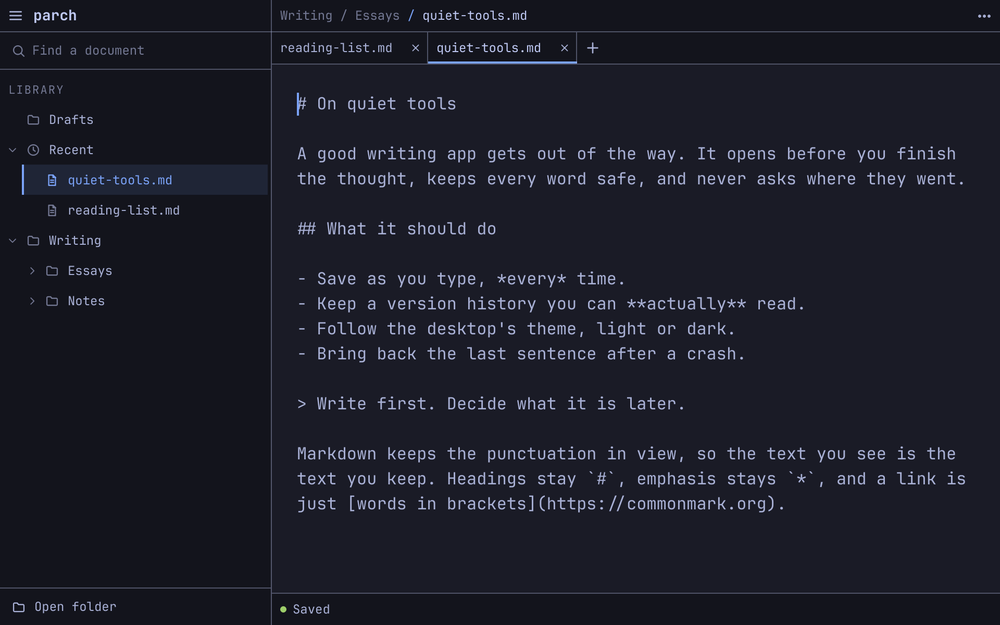

# parch

[](https://github.com/willykev/parch/actions/workflows/build.yml)
[Changelog](CHANGELOG.md) · [Contributing](CONTRIBUTING.md) · [Guide](docs/guide.md)

A Markdown writing app for Omarchy. Open it and write: parch keeps every word
safe and stays out of your way.

- Write Markdown with its punctuation in view, in tabs and separate windows.
- Cite from your BibTeX or CSL bibliography in APA, Chicago, MLA, IEEE or a
  style of your own, chosen per document or per library folder.
- Check your spelling as you write, and dim all but the sentence you are on
  in focus mode.
- Save as you type, and get your text back after a crash.
- Go back to an earlier version of any document from its history.
- See when a file changes on disk, compare, and choose what to keep.
- Keep your folders, drafts and recent files in a library, and find any
  document by name.
- Follow your Omarchy theme automatically, light or dark.

Your writing stays in ordinary Markdown files on your computer. No account or
cloud service is required.

## Install

Build and install from source on Omarchy or Arch Linux:

```sh
git clone https://github.com/willykev/parch.git
cd parch
bin/install
```

This builds and installs the app. Open **parch** from the app launcher, or run
`parch` with the files you want to open.

Building requires a C++ compiler, `make`, `qmake6`, and the `qt6-base`,
`qt6-declarative`, `qt6-svg`, `qt6-wayland`, `fontconfig` and `hunspell`
packages. File dialogs use `xdg-desktop-portal` and your desktop's portal
backend; spell checking uses the `hunspell-en_us` dictionary.

## Start writing

Press **Ctrl+N** for a new draft and start typing. Drafts are kept for you
until you give them a name with **Ctrl+S**; after that, parch saves the file a
moment after you pause.

| Key | Action |
| --- | --- |
| `Ctrl+N` | New draft |
| `Ctrl+O` | Open a file |
| `Ctrl+Shift+O` | Find a document |
| `Ctrl+F` / `Ctrl+Shift+F` | Find in the document / search the library |
| `Ctrl+S` / `Ctrl+Shift+S` | Save now / save as |
| `F9` | Show or hide the library |
| `Ctrl+Tab` / `Ctrl+Shift+Tab` | Next / previous tab |
| `Ctrl+W` | Close the tab |
| `Ctrl+Shift+N` | New window |
| `Ctrl+=` / `Ctrl+-` / `Ctrl+0` | Larger / smaller / theme-sized text |
| `Ctrl+Shift+D` | Focus mode |
| `F11` | Distraction-free writing |
| `F10` | Open the menu |
| `Ctrl+Shift+P` | Find and run any command |
| `Ctrl+B` / `Ctrl+I` / `Ctrl+K` | Bold / italic / link |

## Use the terminal

```sh
parch notes.md ideas.md            # Open files, in the running parch if there is one
parch ~/Writing                    # Add a folder to the library
parch check notes.md               # Find broken links, missing images, notes and includes
parch render notes.md --to text    # The HTML, text, outline or semantic tree
parch export book.md -o book.html  # A web page, or Markdown with its includes in place
parch stats notes.md               # Words, characters and reading time
parch skill install                # Teach your coding agents to use parch
```

The commands need no display and take `--json`. Run `parch --help` for
everything, and `parch help COMMAND` for one command's options.

## Your data

Your documents are your own Markdown files, saved where you put them. parch
keeps its own things separately:

- Drafts and version history in `~/.local/share/parch/`.
- Crash recovery, your open tabs, and recent files in `~/.local/state/parch/`.
- Words you add to the spelling dictionary in `~/.local/share/parch/dictionary.txt`.
- Settings in `~/.config/parch/settings.json`, and document settings in
  `~/.local/share/parch/document-settings.json`.

A formatted preview and exporting from the window are not included yet; the
terminal exports Markdown and HTML.

## Development

```sh
bin/build     # Build into build/parch
bin/test      # Run the tests without opening a window
bin/fetch-helpers  # Fetch the pinned math and diagram helpers into build/helpers
```

See the [full guide](docs/guide.md) for every shortcut and for how saving,
recovery, history, and conflicts work.

[MIT license](LICENSE), with acknowledgments to the upstream projects.
