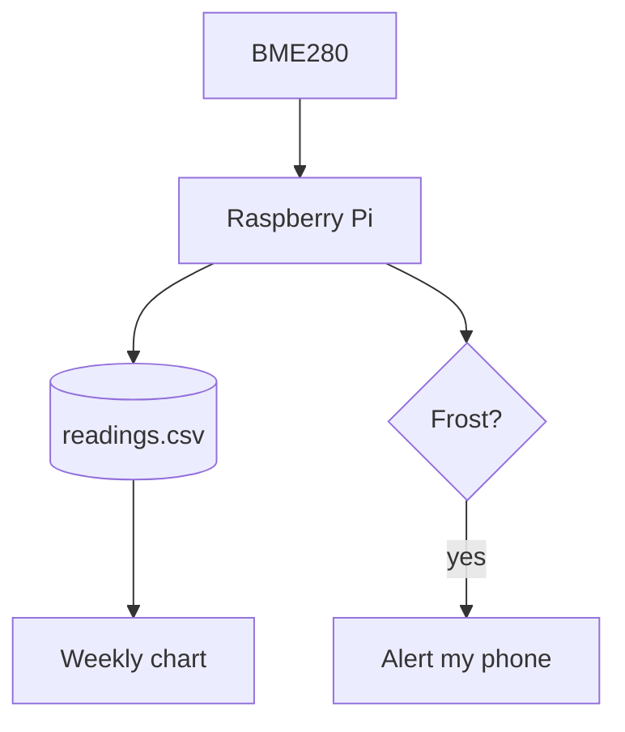
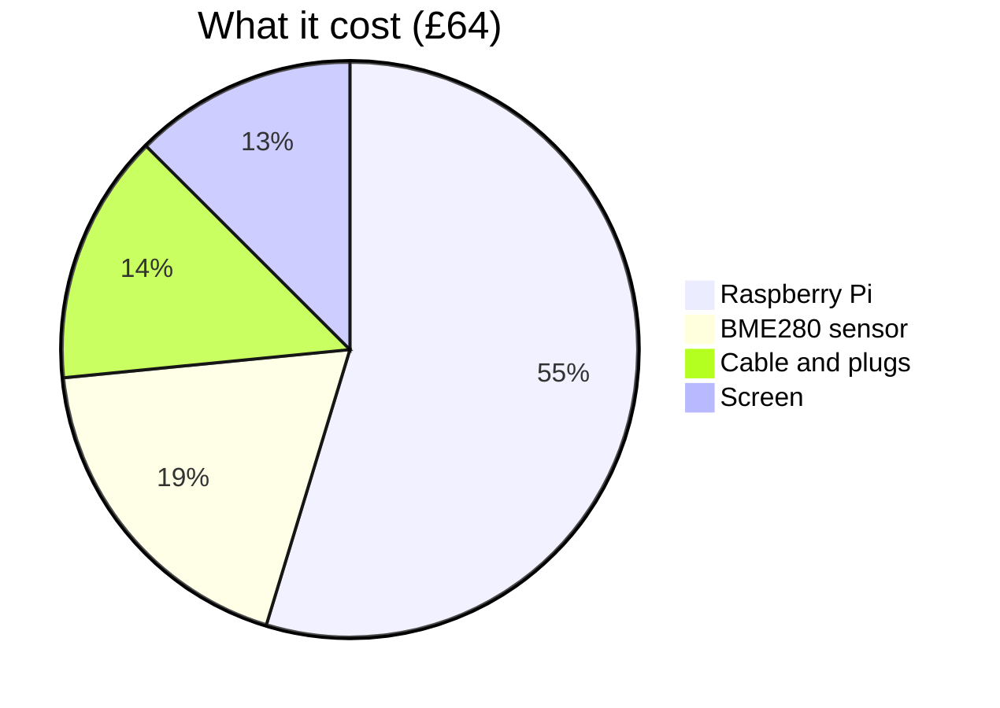

# A weather station for the garden

Over two weekends I put a small weather station on the shed: a BME280 sensor on a Raspberry Pi, logging the temperature and humidity every ten minutes. These are my notes, for the next time something breaks.

## The hardware

The BME280 talks I²C, so it needs four wires: power, ground, SDA and SCL. It sits in a slatted screen on the north wall of the shed, out of the sun[^sun], and the Pi stays indoors at the end of a two-metre cable.

Turn on I²C, install the two libraries, check that the sensor answers at `0x76`, and start the script below:

```sh
sudo raspi-config nonint do_i2c 0
pip install smbus2 RPi.bme280
i2cdetect -y 1
python3 station.py >> readings.csv &
```

## Reading the sensor

The script prints a line every ten minutes:

```python
import bme280, smbus2, time
bus = smbus2.SMBus(1)
cal = bme280.load_calibration_params(bus)
while True:
    s = bme280.sample(bus, 0x76, cal)
    print(s.timestamp, s.temperature,
          s.humidity, sep=",", flush=True)
    time.sleep(600)
```

The dew point, with $a = 17.625$ and $b = 243.04$ °C:

$$
T_d = \frac{b\,\gamma}{a - \gamma}, \qquad
\gamma = \ln\frac{RH}{100}
  + \frac{a\,T}{b + T}
$$

## A Saturday's readings

| Time  | Air °C | RH % | Dew point °C |
|:------|-------:|-----:|-------------:|
| 06:00 |    7.8 |   94 |          6.9 |
| 10:00 |   12.4 |   76 |          8.3 |
| 14:00 |   17.1 |   55 |          8.0 |
| 18:00 |   13.4 |   70 |          8.0 |

## Where the readings go

Every reading goes into a file for the weekly chart, and on a cold night the Pi warns me before the frost comes.



## What it cost

Most of the money went on the Pi; the screen is two plant-pot saucers and a bolt.



+++

## About the dew point

The dew point is the temperature at which the air would be saturated. The formula goes back to @magnus1844, with the constants refined by @alduchov1996. Without a calculator, $T_d \approx T - (100 - RH)/5$ is good to about a degree while the humidity is above 50 % [@lawrence2005].

[^sun]: In direct sun it read up to six degrees high.
