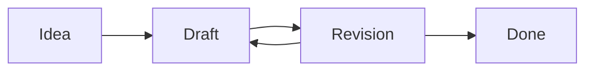

# Markdown guide

This guide is written in Markdown, and you are reading it twice: as text on
the left, and on the right as the preview makes it. Everything on the right
comes from the text on the left, so the best way to learn is to change
something and watch. Break an example, fix it again, add your own lines.

Nothing you change here is kept. The guide is not a draft, it is never
saved, and closing it asks nothing; close it and open it again from the menu,
and it starts fresh. To keep your changes, choose **Save as…**: the copy you
save becomes an ordinary document.

Each part shows the syntax working, and, where it helps, a case that does
not work the way you might expect. Those are marked *Watch out*.

## Paragraphs and line breaks

A paragraph is one or more lines of text. A single line break inside a
paragraph is only a space: these three lines
are read as
one line.

A blank line starts a new paragraph.

To break a line without starting a paragraph, end it with two spaces  
like this, or with a backslash\
like this.

*Watch out:* the two spaces are invisible. If a line break does not appear,
look for a missing space rather than adding more blank lines.

A line of three or more `-`, `*` or `_` after a blank line draws a rule:

* * *

## Headings

A line that starts with one to six `#` and a space is a heading. The number
of `#` is its level; this guide uses level two for its parts.

### A third-level heading

#### A fourth-level heading ####

The closing `#` on the line above are optional and never shown.

### A heading with a label [Label example]

The words in brackets at the end of that heading are a label: they are not
shown, and a link can use them, as in [the labelled heading][Label example].

*Watch out:* without the space, `#5` is not a heading:

#5 bolts and a washer

Underlining a line with `=` or `-` makes a level one or level two heading:

Underlined heading
------------------

*Watch out:* a line of `---` right under a paragraph underlines it as a
heading instead of drawing a rule. Leave a blank line before a rule.

## Emphasis

Wrap words in one `*` or `_` for *italic* or _italic_, in two for **bold**
or __bold__, and in three for ***both at once***. They nest:
**bold with _italic_ inside**.

Asterisks work inside a word, as in in*ter*word; underscores do not, so
snake_case_names stay as they are written.

*Watch out:* emphasis needs a closing mark. This *never closes, so the
asterisk stays on the page.

*Watch out:* a mark next to a space cannot open or close: 2 * 3 * 4 is
arithmetic, not italic.

A backslash makes a mark literal: \*not italic\* and \_not italic\_.

## Strikethrough, highlight, superscript and subscript

Two tildes strike text out: ~~no longer true~~. Two equals signs mark it:
==worth remembering==.

A caret raises what follows it up to a space or punctuation, as in 100m^2,
and a pair of carets raises a longer expression: y^(a+b)^. A single tilde
lowers it: H~2 or x~i,j~.

*Watch out:* in a footnote marker such as `[^1]` the caret is not a
superscript, and inside code nothing is formatted: `100m^2`.

*Watch out:* a raised or lowered run stops at a space, so in x^two words^
only the first word is raised, and the last caret stays as written.

## Links and images

A link puts its text in brackets and its address in parentheses:
[an example site](https://example.org "A title, shown on pointing").
The quoted words are a title, shown when you point at the link.

A reference link keeps the address out of the sentence: [this example][ex]
and the shorter [ex][] both use the definition below, which is not shown.

[ex]: https://example.org "An example site"

Addresses in angle brackets, such as <https://example.org>, and bare ones,
such as https://example.org or someone@example.org, are links too.

A `#` and a heading's name lead to that heading: [back to the
headings](#headings). Lowercase it, and put hyphens for spaces.

An image is a link with `!` in front. Its text is what it shows when it
cannot be shown, and what a screen reader says:


*Watch out:* a picture that is not there says so in its place:


## Lists and task lists

A list item starts with `-`, `*` or `+` and a space, or with a number and a
period:

- Paper
- Pencils
  - Soft ones, indented under their parent
- An eraser

1. Write
2. Read it again
3. Rewrite

Task lists put a box after the marker; tick it in the preview and the text
follows:

- [x] Draft the chapter
- [ ] Check the quotations
- [ ] Send it

*Watch out:* in this guide's profile a numbered list counts from 1, whatever
number it starts with. The list below starts at 7 in the text:

7. Seventh?
8. Eighth?

*Watch out:* a line that starts with a number and a period is a list even
when you meant a year. A backslash keeps it a sentence:

1984\. A good year for typewriters.

## Quotes

A line that starts with `>` is quoted. Lines that follow it belong to the
quote until a blank line:

> Write the way you talk,
and the quote goes on.
>
>> A quote inside a quote takes two.

## Code

Backticks mark code inside a sentence: `print("hello")`. To show a backtick
inside code, use two around it: `` a`b ``.

A block of code goes between lines of three backticks or tildes, and the
word after the opening ones names its language for colouring:

```python
def greet(name):
    return f"Hello, {name}!"
```

~~~
Tildes work the same way.
~~~

    Four spaces at the start of each line
    make a code block too.

*Watch out:* a fence closes only at a fence at least as long as the one that
opened it, which is how this block shows three backticks as text:

````markdown
```
Inside the outer fence, this is plain text.
```
````

A fence that is never closed runs to the end of the document, taking
everything after it into the code.

## Tables

A table is rows of cells between pipes, with a line of dashes under the
header. Colons in that line align the column:

| Item        | Count | Price |
| :---------- | :---: | ----: |
| *Notebooks* |   3   |  4.50 |
| Pens        |  12   |  0.90 |
| Total       |       | 24.30 |

In this guide's profile, two pipes together join a cell with the next one:

| Morning | Afternoon | Evening |
| ------- | --------- | ------- |
| Writing            || Reading |

A pipe inside a cell needs a backslash: `a \| b` shows as a | b.

*Watch out:* without the line of dashes there is no table, only text with
pipes in it:

| Not | a table |
| still | text |

## Footnotes

A footnote reference is a caret and a label in brackets.[^first] Its text is
written anywhere, after the same label and a colon, and the notes are
gathered at the end, numbered in the order they are first used.

[^first]: This is the footnote's text. It can run on to
    further lines when they are indented.

In this guide's profile a note can also be written in place.[^This one is
written right where it is used.]

*Watch out:* a label with no text for it stays in view, as written, so that
you can see what is missing: [^nowhere].

## Citations

Citations name works in a bibliography. This guide's front matter names
`sample.bib`, a small bibliography beside it, and the APA style, so the
citations below read as APA writes them.

In square brackets, `@` and a key cite a work, with a locator after a comma:
[@vale2019, p. 12]. Several works go together, each with words of its own
before it: [see @okafor2021, pp. 44-45; also @vale2019].

When the sentence names the author already, a minus leaves the name out:
Vale says so too [-@vale2019]. Without brackets, the key is the author in
your sentence: @okafor2021 found the same.

Works can also be defined in the text itself, as a label starting with `#`,
and cited with a locator in the first brackets[p. 3][#Marsh:2015].

[#Marsh:2015]: Ada Marsh. *Notes on Margins*. Quiet Lane Press, 2015.

*Watch out:* a key that no bibliography has is shown, marked, as it is
written: [@nobody2020]. And an `@` inside a word is no citation: e-mail
someone@example.org as usual.

## Math

Dollar signs hold math, which the preview typesets: $e^{i\pi} + 1 = 0$
inline, and on lines of its own between double dollars:

$$
x_{1,2} = \frac{-b \pm \sqrt{b^2 - 4ac}}{2a}
$$

*Watch out:* prices are not math. $5 and $10 stay as they are, because math
needs no space just inside its dollar signs. A backslash keeps one literal:
\$x\$.

## Diagrams

A code block in the `mermaid` language is drawn as a diagram:



## Front matter and variables

The lines between `---` at the very top of this guide are its front matter:
settings about the document, not part of its text. They name the
bibliography and the citation style, and any value can be put in the text
by its name in brackets after `%`: this is [%title], by [%author].

*Watch out:* a name the front matter does not have stays as written:
[%subtitle].

*Watch out:* front matter counts only at the very start. The same lines
further down are a rule and a heading:

---
title: Not metadata
---

## Includes

A line that names another Markdown file, alone in its paragraph, puts that
file's text here. The quoted words after it are a caption:

guide-include.md "An included file"

A path that starts with `/` is found in the library root, as in
`/chapters/one.md`; any other is found beside the document that names it.

*Watch out:* a file that is not there leaves the line as it is:

missing-chapter.md

## Comments and HTML

<!-- An HTML comment is never shown in the preview or an export. -->

A line that starts with `//` is a comment as well:

// This line stays in the text and nowhere else.

Some HTML is understood and drawn as its Markdown would be: <kbd>Ctrl</kbd>
plus <kbd>S</kbd>, H<sub>2</sub>O, E = mc<sup>2</sup>, and a line<br>break.

*Watch out:* other HTML is shown as text, never run or hidden:
<marquee>no scrolling here</marquee> and <script>alert("no")</script>.

## Definition lists

A term on one line and its meaning on the next, after a colon:

Margin
: The blank space around the text of a page.

Gutter
: The inner margins, where the pages meet.
: Also the space between columns.

## Page breaks

Three plus signs alone on a line, after a blank line, start a new page when
the document is printed or exported to PDF:

+++

In the preview it is a marked line.

## Contents

A paragraph of `{{TOC}}` alone lists every heading of the document, linked:

{{TOC}}

## Profiles and the Writer extensions

parch reads Markdown in one of two profiles, chosen in **Document
settings…** for a document, a library folder or every document.

**Writer-compatible**, the default and this guide's, reads standard Markdown
and the extensions writers use: highlight, superscript and subscript, notes
written in place, citations, variables, includes, comment lines, page
breaks, merged table cells, heading labels and lists that always count from
one. Math, diagrams, definition lists and bibliographies are extensions too,
which you can turn on or off one by one.

**Standard** follows CommonMark with GitHub's tables, strikethrough, task
lists and bare links, and reads nothing else: `==marked==` stays as written,
and the list that starts at 7 starts at 7.

Open **Document settings…** now and choose Standard for this guide to see
which parts of it change. Like everything here, that choice is not kept.
