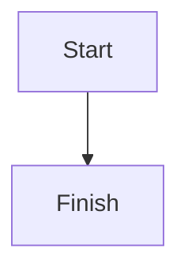

{{TOC}}

# Opening Heading

A paragraph with *emphasis*, **strong text**, ~~struck words~~, ==highlighted words==,
x^2^ and H~2~O, `inline code`, a [link to the web](https://example.org/page),
a [link to the closing section](#closing-section) and an autolink <https://example.com>.
Line one ends here\
and line two follows a hard break.

## Lists Heading

- First bullet
- Second bullet
  - Nested bullet
- [x] Done task
- [ ] Open task

3. Third numbered
4. Fourth numbered
   1. Nested numbered

> A quoted paragraph that stands apart.
>
> A second quoted paragraph.

Term one
: The first definition.

## Table Heading

| Left | Centre | Right |
|:-----|:------:|------:|
| a1 | b1 | c1 |
| merged across || c2 |

```python
def greet(name):
    return "hello " + name
```

---

## Notes Heading

A sentence with a note.[^first] Another with an inline note.[^The inline note's text.]
A citation of a work [p. 23][#doe] stands here.

[^first]: The first note's text.

[#doe]: Doe, Jane. *A Book of Examples*. Example Press, 2020.

+++

## Pictures Heading

Inline math $E = mc^2$ sits on the line.

$$
\int_0^1 x^2 \, dx = \frac{1}{3}
$$




# Closing Section

The last paragraph of the document.
